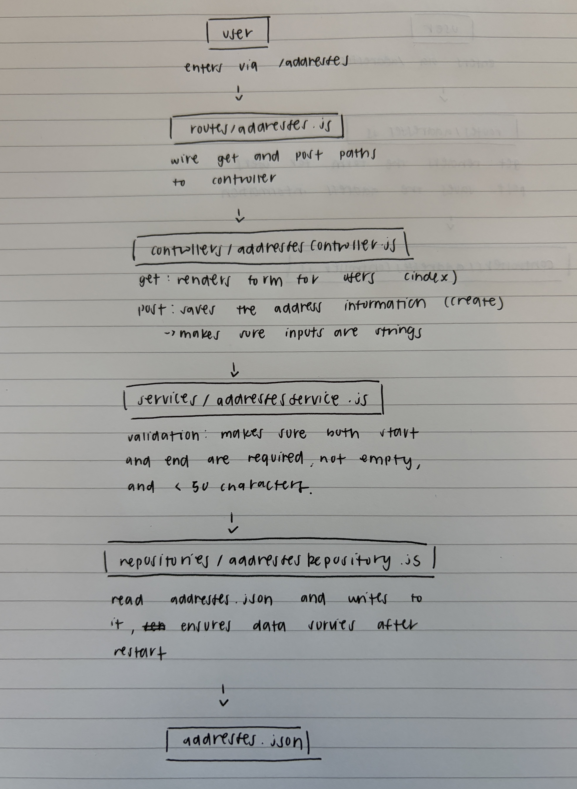

## Section 1: Table with Team Members Information

| Name              | GitHub Username |
| ----------------- | --------------- |
| Rachel Gao        | rgao05          |
| Shritan Kondaveti | skondaveti-sys  |
| Nitya Vobugari    | nityavobugari18 |
| Daniela Ramos     | msobriquet      |

## Section 2: Working Agreement

- We will communicate day-to-day using our group chat on iMessages. Occasionally we can call or use zoom if needed.
- "Done" for a pull request means that it is complete, doesn't cause any errors, and is reviewed by at least one team member.
- We will solve disagreements by bringing them up and discussing the problem with one another in a civil manner. Each of us can voice our thoughts on the matter and then as a team come to some sort of compromise where the issue is addressed/solved in a way that everyone agrees seems fit and benefits the project. If the disagreement is still unresolved we can ask an outside party for advice.

## Section 3: Project Domain
Our team was thinking of building some sort of public transportation helper. Some of us found that information like cost, time schedules, and routes were not easily accessible. We would have to dig through multiple links online, or read the many confusing signs on public transportation stops to get the information we needed. So this helper can make transit information less confusing to navigate and have all of it in one place. This would benefit other students like us, those who come from a low-income background, and senior citizens.

## Section 4: How to run it
In order to run our program, you should clone the repository on github, run ```npm install``` to download the neccesary dependencies, and then run ```npm start``` to run the server on your local machine. Visit localhost:3000 to see the home page. *This is subject to change, considering it is not the most accessible for our current target audience.*

## Feature: report an outage

Go to `/outages`. Enter a station and a description of what is not working (for example "Elevator to platform B is out"), next you press "Report outage". The report is sent to the server (`POST /outages`), saved, and appears in the "Reported outages" list on the page without a reload. It is still there after a refresh or a server restart.

If either field is empty, the server answers 400 with "Enter both a station and a description of the problem." and nothing is saved. If the server cannot be reached, the page informs us of that. A malformed request body also gets a 4xx response, and the server keeps running.

Checking trips against reported outages is not built yet.

## Feature: Allowing User to Input Starting and End Address

This feature allows us to understand where the user is currently and then the destination they want to go to from what they type in. To use this feature, head to the `/addresses` route. There should be a form side by side, one side would allow the user to input the starting location and the other side would allow the user to input their destination. After submitting, the inputted information gets saved onto the addresses.json file.

## System Diagrams

```
Browser: /outages page (views/outages.ejs + public/outages.js)
  GET /outages                 POST /outages {station, description}
        |                              |
        v                              v
server.js     json parsing, 404, error handler
        |
        v
routes/outages.js                wires paths to controller functions, wrapped in asyncHandler
        |
        v
controllers/outagesController.js reads req, calls the service, sends res (200 render / 201 json / error status)
        |
        v
services/outagesService.js       validation: station and description required (400); uses dtos/outageDto.js
        |
        v
repositories/outagesRepository.js  only file that reads and writes storage
        |
        v
data/outages.json
```

<!-- Teammates: add your slice's path to this diagram, next to the one I put above. -->



## Design Decisions

Shritan Kondaveti: I created the feature that reports the outages. I made the decision to create a check that makes sure the station and description are filled in is in the service file (outagesService.js), not the controller. The controller simply just passes the form data to the service and sends back whatever the service says. An alternative is to do the check in the controller. That would have been worse because we won't be able to test the rule without faking a request, and any other code that creates an outage would skip the check.I think what we have is a lot better overall because the service only works with plain data, so the rule can be tested on its own and applies everywhere.

Rachel Gao: For the address feature I placed validations in both the controller layer and the service layer. The reason for this is because in the controller level I wanted to check to make sure the addresses/stations inputted were strings and not coordinates or a bunch of random numbers. This relates to a request being well-formed. Because if the address/station is not even valid or is a request we can't take, it would send an error right away instead of just allowing it to continue to the service layer. This is why I chose not to put all the validation in the service layer even though that could have been an option. Then in the service layer validation relating to business rules were implemented here, including both the start and end addresses being inputted and not empty, and also making sure the user isn't inputting paragraphs. 

Nitya Vobugari: For the address form I made the browser submit with fetch in public/app.js instead of a normal form POST that reloads the page. Our controller answers with JSON, either the saved route or an error message with a 400 status, so the script checks response.ok and writes that message into an aria-live area on the same page, and the user keeps what they typed. The alternative was a plain form POST where the controller re-renders addresses.ejs with an error variable. That works without JavaScript, but a full reload on every submit means a screen reader has to read the page again, and the controller would have to build page data for every failure. The cost of my version is that the page depends on JavaScript: if app.js fails to load, the form falls back to a plain POST and shows raw JSON.