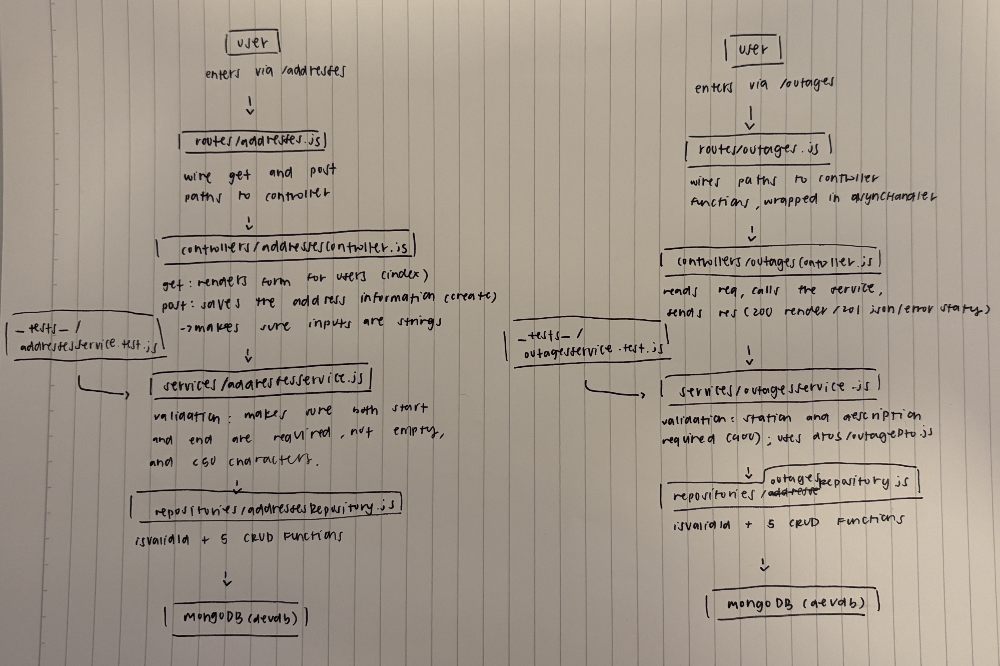

## Section 1: Table with Team Members Information

| Name              | GitHub Username |
| ----------------- | --------------- |
| Rachel Gao        | rgao05          |
| Shritan Kondaveti | skondaveti-sys  |
| Nitya Vobugari    | nityavobugari18 |

## Section 2: Working Agreement
- We will communicate day-to-day using our group chat on iMessages. Occasionally we can call or use zoom if needed.
- "Done" for a pull request means that it is complete, doesn't cause any errors, and is reviewed by at least one team member.
- We will solve disagreements by bringing them up and discussing the problem with one another in a civil manner. Each of us can voice our thoughts on the matter and then as a team come to some sort of compromise where the issue is addressed/solved in a way that everyone agrees seems fit and benefits the project. If the disagreement is still unresolved we can ask an outside party for advice.

## Section 3: Project Domain
Our team was thinking of building some sort of public transportation helper. Some of us found that information like cost, time schedules, and routes were not easily accessible. We would have to dig through multiple links online, or read the many confusing signs on public transportation stops to get the information we needed. So this helper can make transit information less confusing to navigate and have all of it in one place. This would benefit other students like us, those who come from a low-income background, and senior citizens.

## Section 4: How to run it
Begin by cloning the repository, do this by entering `git clone https://github.com/skondaveti-sys/Team3-workspace` into your terminal. Run `npm install` to download the necessary dependencies. Run `npm start` to run the server on your local machine and open the pop-up onto your browser, visit localhost:3000.

To start up MongoDB, run `dc-up mongo` in your terminal. To check that it is running make sure that when running `dps` it lists `mongo`. Finally connect by typing `mongo-dev` into your terminal. Type `exit` to leave the shell.

## Feature: Report an outage
Go to `/outages`. Enter a station and a description of what is not working (for example "Elevator to platform B is out"), next you press "Report outage". The report is sent to the server (`POST /outages`), saved, and appears in the "Reported outages" list on the page without a reload. It is still there after a refresh or a server restart.

If either field is empty, the server answers 400 with "Enter both a station and a description of the problem." and nothing is saved. If the server cannot be reached, the page informs us of that. A malformed request body also gets a 4xx response, and the server keeps running.

Checking trips against reported outages is not built yet.

## Feature: Allowing User to Input Starting and End Address
This feature allows us to understand where the user is currently and then the destination they want to go to from what they type in. To use this feature, head to the `/addresses` route. There should be a form side by side, one side would allow the user to input the starting location and the other side would allow the user to input their destination. After submitting, the inputted information gets saved onto the addresses.json file.

## System Diagrams

## Sprint 3 Changes
1. Swap to MongoDB: Both the /addresses and /outages feature routes hit MongoDB. Both the repository files changed for these features. Rather than reading and writing to addresses.json and data outages.json, the data can now be more flexibly managed in MongoDB. When swapping from file to real database we ran into the exception. Changes were made to views/outages.ejs and dtos/outageDto.js as previously outage.id was used to refer to the assumed array position however now due to swapping to MongoDB outage.id becomes outage._id in order to get the real MongoDB id.
2. Jest tests for the service layer: Both services, addressesService.js and outagesService.js, now have Jest tests in the __tests__ folder (addressesService.test.js and outagesService.test.js). For addresses the tests check that empty or whitespace-only addresses are rejected, that addresses over 50 characters are rejected while exactly 50 is accepted, and that a valid journey is saved. For outages they check that a missing station, a missing description, whitespace-only fields, non-string fields, and no data at all are rejected, that valid input is trimmed before it is saved, and that listOutages returns what the repository has. Rather than connecting to MongoDB, the tests replace the repositories and the outage DTO with fakes using jest.unstable_mockModule, so they run in about a second with no database. To see it run npm install and then npm test, which should show 2 passing suites and 13 passing tests with MongoDB stopped.

## Design Decisions

### Sprint 2
Shritan Kondaveti: I created the feature that reports the outages. I made the decision to create a check that makes sure the station and description are filled in is in the service file (outagesService.js), not the controller. The controller simply just passes the form data to the service and sends back whatever the service says. An alternative is to do the check in the controller. That would have been worse because we won't be able to test the rule without faking a request, and any other code that creates an outage would skip the check.I think what we have is a lot better overall because the service only works with plain data, so the rule can be tested on its own and applies everywhere.

Rachel Gao: For the address feature I placed validations in both the controller layer and the service layer. The reason for this is because in the controller level I wanted to check to make sure the addresses/stations inputted were strings and not coordinates or a bunch of random numbers. This relates to a request being well-formed. Because if the address/station is not even valid or is a request we can't take, it would send an error right away instead of just allowing it to continue to the service layer. This is why I chose not to put all the validation in the service layer even though that could have been an option. Then in the service layer validation relating to business rules were implemented here, including both the start and end addresses being inputted and not empty, and also making sure the user isn't inputting paragraphs.

Nitya Vobugari: For the address form I made the browser submit with fetch in public/app.js instead of a normal form POST that reloads the page. Our controller answers with JSON, either the saved route or an error message with a 400 status, so the script checks response.ok and writes that message into an aria-live area on the same page, and the user keeps what they typed. The alternative was a plain form POST where the controller re-renders addresses.ejs with an error variable. That works without JavaScript, but a full reload on every submit means a screen reader has to read the page again, and the controller would have to build page data for every failure. The cost of my version is that the page depends on JavaScript: if app.js fails to load, the form falls back to a plain POST and shows raw JSON.

### Sprint 3
Shritan Kondaveti: In this sprint, I wrote Jest tests for our service layer with the repositories mocked using `jest.unstable_mockModule`, following Unit 13, instead of testing against a real MongoDB. Our services, `saveAddresses` and `createOutage`, hold the rules like required fields and the 50-character limit, and they only call the repository through its exported functions therefore a mock can stand in for it. That keeps the suite at about one second and lets it pass with no database running, which is required in this sprint. It also lets a test check that the repository was never called when input is rejected. An alternative would be to run integration tests against a real MongoDB. That would have
cost us a running database for every test run and slower tests. The tradeoff is that mocked tests can't catch bugs between layers, such as a view reading `_id` when the DTO returns `id`, so we still have to check that by hand in the browser.

Nitya Vobugari: I converted the “Report outage” form to HTMX. The form uses hx-post, and the server returns one <li> from the partial views/partials/outage-item.ejs. The alternative was keeping the fetch code in public/outages.js, which built each new list item in the browser with buildItem. I chose HTMX because that form was the only interaction on the page that did a manual fetch and DOM update, and the outages page has no delete or edit to convert instead. Now one EJS partial renders both the rows on page load and each new row, so the markup and the id live in one place. Keeping the old way would have meant a second copy of the list-item markup in JavaScript that had to stay in sync with the template, and the move to MongoDB had already broken that script once when ids changed from id to _id. The tradeoff is that the page now depends on the htmx script loading, and the server has to check the HX-Request header to return a fragment instead of JSON.
